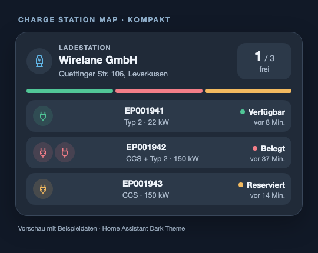
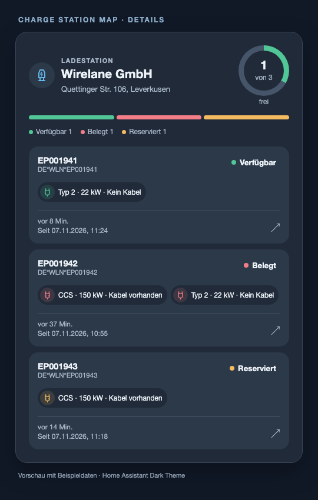

# Charge Station Map for Home Assistant

Charge Station Map shows nearby charging stations from the EnBW API in Home Assistant. Search by area, filter stations by operator, plug type and power, and monitor each charge point's state in the included dashboard cards.

[](https://my.home-assistant.io/redirect/hacs_repository/?owner=isertkaya&repository=Charge-Station-Map&category=integration)

Select your Home Assistant instance, add the repository if prompted, and install
**Charge Station Map**. The button opens HACS on older Home Assistant versions
and the Marketplace on Home Assistant 2026.11 or newer.

## Notice of Non-Affiliation and Disclaimer

We are not affiliated, associated, authorized, endorsed by, or in any way officially connected with EnBW Energie Baden-Württemberg, or any of its subsidiaries or its affiliates. The official EnBW Energie Baden-Württemberg website can be found at [https://www.enbw.com/](https://www.enbw.com/). The map to find nearby charge stations can be found [here](https://www.enbw.com/elektromobilitaet/unterwegs-laden#ladestations-finder)

## Description

Use station and charge-point entities in automations, scripts and dashboards.

## Features

- One enum sensor per charge point showing the exact API state:
  `AVAILABLE`, `OCCUPIED`, `RESERVED`, `BLOCKED`, `OUT_OF_SERVICE`, or `UNKNOWN`
- Sensor counter to display the number of total, free and unknown state charge points
- Opening hours: a sensor showing whether the station is currently open, plus
  diagnostics for 24/7 operation, holiday closures, human-readable opening
  hours, and the next opening/closing time
- A device tracker per station exposing its location, so stations can be shown on the Home Assistant map and used with the Proximity integration
- Easy integration using the search feature
- Optional search filters for multiple operators, plug types and minimum charging power
- Operator sensor and operator attribute on the station availability entity
- Per-connector plug type, power and attached-cable details on each charge point
- Stable charge point identities based on EVSE IDs; newly reported charge points
  are added automatically during the next update
- The point's status sensor also contains its connectors, power, attached-cable
  information and the API status timestamp. The former duplicate charge-point
  binary sensors are removed when the integration starts. Station availability
  remains a separate binary sensor because opening hours affect it.
- `updatedAt` reflects the API's latest charge point state timestamp, rather
  than the time Home Assistant last fetched the station.
- Two Lovelace cards show the operator, available versus total charge points,
  and every charge point's exact status and time in that status.
- A local integration icon on Home Assistant 2026.3 or newer

### Monitoring multiple charging stations

Charge Station Map uses the `charge_station_map` integration domain. Add stations
through **Settings → Devices & Services → Add integration**.

Each charge station is configured as its own entry. To monitor several stations,
add the integration multiple times — once per station. Every station becomes its
own device with its own set of entities. When a shared API key is renewed through
re-authentication, all stations using the old key receive the new key.


## Install with HACS or Marketplace

This project is a custom integration repository. Add its URL once; HACS or the
Home Assistant Marketplace then installs and updates it. No file copying is
needed.

- **Home Assistant 2026.11 or newer:** Open **Settings → Marketplace → Add from
  link**, enter `https://github.com/isertkaya/Charge-Station-Map`, and select
  **Add**. Open **Charge Station Map** in the Marketplace and select **Install**.
- **Older Home Assistant with HACS:** Open **HACS → ⋮ → Custom repositories**,
  enter `https://github.com/isertkaya/Charge-Station-Map`, select **Integration**
  as the category, and add it. Open **Charge Station Map** in HACS and select
  **Download**.

Follow any restart prompt shown after installation or an update. Then open
**Settings → Devices & Services → Add integration** and search for **Charge
Station Map**. The two dashboard cards are registered automatically when the
integration is set up.

[](https://my.home-assistant.io/redirect/config_flow_start/?domain=charge_station_map)

## Set up a station

1. Obtain an API key from the [EnBW charge station finder](https://www.enbw.com/elektromobilitaet/unterwegs-laden#ladestations-finder). Open your browser's developer tools and network monitor, search for a station and open its details. Find a request such as `https://api.emp.emob-enbw.com/emobility-public-api/api/v1/chargestations/{STATION_NUMBER}` and copy the hexadecimal value of its `Ocp-Apim-Subscription-Key` request header.
2. In the **Charge Station Map** setup form, enter the API key. Further stations reuse it automatically.
3. Move the marker on the map to the area you want to search and set the radius. The search expands grouped API results and includes individual stations within that radius.
4. Optionally select one or more operators and plug types from the values found in the area. A station matches when at least one selected operator and at least one selected plug type match. You can also set a minimum power in kW; it is compared against `maxPowerInKw`.
5. Select a station from the filtered results. Each option shows operator, power, distance from the search center, and address in that order.

New station entries and device names show the operator before the address.
Existing device names update after the integration reloads, and later API
changes to the operator or address are reflected automatically.

If the station you want does not show up in the results, enlarge the search
radius or move the marker closer to it. A specific station number can also be
set afterwards via **Configure** on the integration entry. Changing the station
number retains the station device and its station-level entity IDs. Charge point
entities from the previous physical station are removed and replaced with the
new station's EVSE IDs.

## Dashboard cards

| Compact | Detailed |
| --- | --- |
|  |  |

These previews use example station data and the Home Assistant dark theme.

The integration includes **Charge Station Map · Kompakt** and **Charge Station
Map · Details**. Both cards find and show **all** charge points of the selected
station automatically, including points added later. The compact card is a
station overview with a status strip and one short row per charge point. Each
row shows the EVSE ID suffix, plug type icons, maximum power, status and relative
status age. The detailed card uses a free-point gauge and individual charge
point tiles with every connector's icon, plug type, power and cable information,
plus the full EVSE ID and exact status time. Tap the station, a charge point or
its segment in the status strip to open its Home Assistant details. The time
comes from the API's `updatedAt` field; if the API does not provide one, the
card says that the time is unknown.

Both cards follow the active Home Assistant theme and use rounded, Mushroom-like
icon bubbles. In the visual card editor, choose the station and customize the
heading, address, status strip, power, status time, plug labels and tap action.
The detailed card also lets you show or hide cable information. The default
tap action opens Home Assistant details; the editor also supports no action or
navigation to a dashboard page. Standard Home Assistant `tap_action` settings
can be set in YAML.

With the usual Home Assistant dashboard settings, the integration registers
its card resource automatically. After restarting Home Assistant and reloading
the browser page, choose **Charge Station Map · Kompakt** or **Charge Station
Map · Details** in the dashboard card picker and select the station. The
selector lists station availability entities. You can also add one from a
station entity's suggested cards. Home Assistant does not add cards to an
existing dashboard on its own, so you still choose where each card belongs.

If you explicitly manage Lovelace resources in YAML, add the module once to
your Lovelace resource configuration:

```yaml
lovelace:
  resource_mode: yaml
  resources:
    - url: /charge_station_map/charge-station-map-card.js
      type: module
```

After an update from an older version, refresh the browser cache if you still
see the earlier card design.

You can also add the cards directly in dashboard YAML. Replace the example
entity ID with your station's **availability binary sensor**:

```yaml
type: custom:charge-station-map-compact-card
entity: binary_sensor.my_station_availability
title: Ladepark am Bahnhof
plug_style: icon_text
show_power: true
tap_action:
  action: more-info
```

```yaml
type: custom:charge-station-map-detail-card
entity: binary_sensor.my_station_availability
```

The station availability sensor can report `off` when a station is closed even
if the API reports free points. The cards show the API's free/total count and
also indicate that the station is closed.

If an automation used a former **charge-point binary sensor**, change its
trigger or condition to the corresponding charge-point status sensor. For
example, use the state `OCCUPIED` for occupied and `AVAILABLE` for free.

## Removing the integration

Remove the charge station device (or its config entry) from
**Settings → Devices & Services → Charge Station Map**. No additional cleanup
is required.

## Troubleshooting

- **Entities are unavailable:** the integration polls the EnBW cloud API every
  60 seconds. Temporary API outages mark entities as *unavailable* until the next
  successful update; they recover automatically.
- **Availability and point count differ:** the count sensor shows the API's raw
  number of free charge points. The station availability binary sensor also
  takes opening hours into account.
- **API key rejected:** if the API key expires, Home Assistant raises a
  re-authentication prompt. Provide a fresh key obtained from the EnBW charge
  station finder as described above.

## Development

The test suite runs against a real Home Assistant core via
[pytest-homeassistant-custom-component](https://github.com/MatthewFlamm/pytest-homeassistant-custom-component):

```bash
pip install -r requirements-test.txt
pytest
```

The pinned `pytest-homeassistant-custom-component` version determines which
Home Assistant release the tests run against — bump it to test against a newer
core.

## Publishing

The integration manifest points to
[isertkaya/Charge-Station-Map](https://github.com/isertkaya/Charge-Station-Map)
for documentation and issue reports. Make the repository public, add a short
GitHub description and relevant topics, and enable Issues. Push the files and
check that the Tests, HACS validation and Home Assistant validation workflows
pass. Then create a GitHub release for version `3.9.0`. The GPL-3.0 license
and the origin notice below must remain with the published source.

## Origin and license

This project is based on [mKenfenheuer/enbw_chargestations](https://github.com/mKenfenheuer/enbw_chargestations), originally released under the GNU General Public License version 3. Modified in 2026, Charge Station Map has a separate integration domain and adds a redesigned setup flow, station filters, additional entities and dashboard cards. The modified project remains available under GPL-3.0; see [LICENSE](LICENSE). It is an independent community project and is not affiliated with EnBW or the original maintainer.
